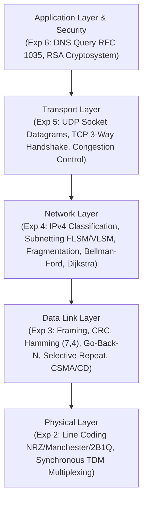
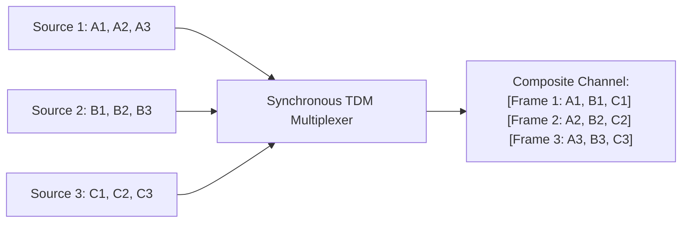
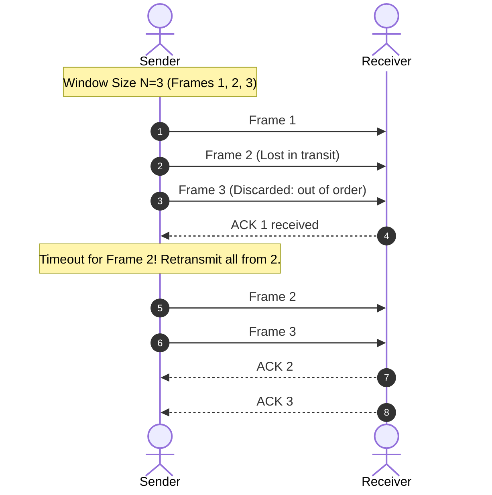
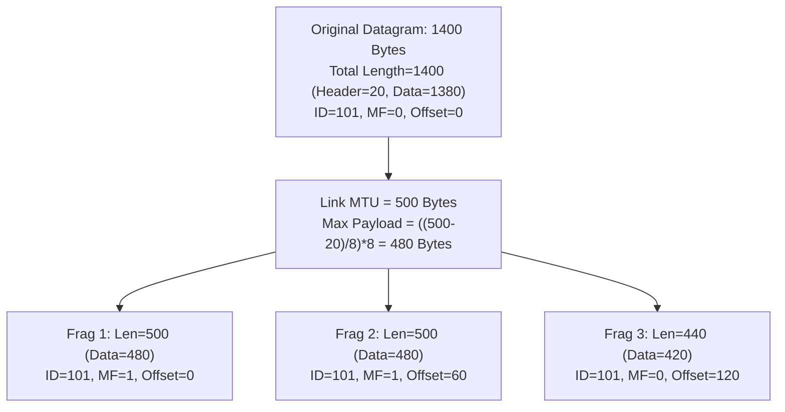
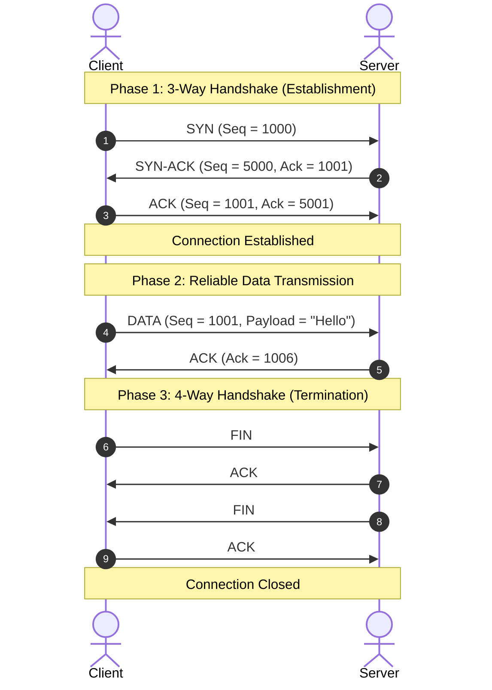
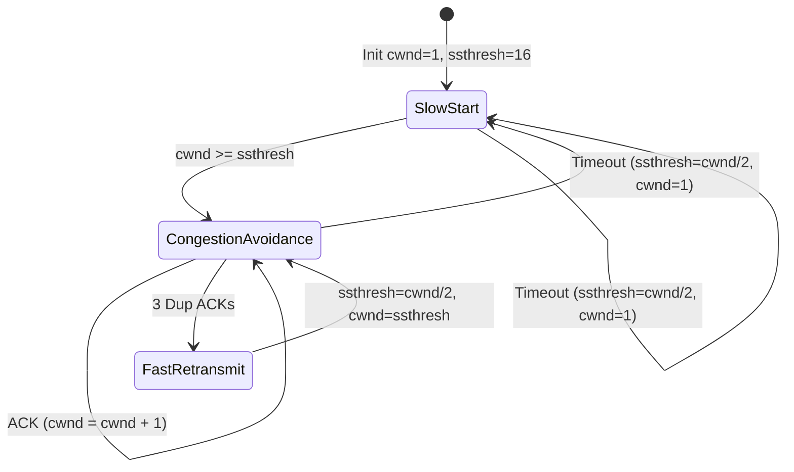

# Computer Networks Laboratory (CN Practicals)

A comprehensive repository containing C implementations of core computer networking concepts, protocols, and algorithms across the **OSI / TCP-IP reference model**. Each program provides a practical, code-level demonstration of theoretical principles ranging from Physical Layer line coding to Application Layer DNS queries and RSA cryptography.

---

## 📑 Table of Contents

- [Overview & Architecture](#-overview--architecture)
- [Repository Structure](#-repository-structure)
- [Experiment 2: Physical Layer (Line Coding & Multiplexing)](#-experiment-2-physical-layer)
  - [2.1 Polar NRZ (NRZ-L & NRZ-I)](#exp-21-polar-nrz-line-coding-nrz-l-and-nrz-i)
  - [2.2 Biphase Encoding (Manchester & Differential Manchester)](#exp-22-biphase-line-coding-manchester-and-differential-manchester)
  - [2.3 Multilevel 2B1Q Encoding](#exp-23-multilevel-line-coding-2b1q)
  - [2.4 Line Coding & Scrambling Overview](#exp-24-bipolar-scrambling-and-block-coding)
  - [2.5 Synchronous Time Division Multiplexing (TDM)](#exp-25-synchronous-time-division-multiplexing-tdm)
- [Experiment 3: Data Link Layer (Framing, Error Control & MAC)](#-experiment-3-data-link-layer)
  - [3.1 Cyclic Redundancy Check (CRC)](#exp-31-cyclic-redundancy-check-crc)
  - [3.2 Hamming Code (7,4) Error Correction](#exp-32-hamming-code-74-error-detection-and-correction)
  - [3.3 Character / Byte Stuffing & Destuffing](#exp-33-character--byte-stuffing-and-destuffing)
  - [3.4 Bit Stuffing & Destuffing](#exp-34-bit-stuffing-and-destuffing)
  - [3.5 Go-Back-N ARQ Protocol](#exp-35-go-back-n-sliding-window-arq)
  - [3.6 Selective Repeat ARQ Protocol](#exp-36-selective-repeat-sliding-window-arq)
  - [3.7 CSMA/CD with Exponential Backoff](#exp-37-csmacd-with-truncated-binary-exponential-backoff)
- [Experiment 4: Network Layer (Addressing, Subnetting, Fragmentation & Routing)](#-experiment-4-network-layer)
  - [4.1 IPv4 Address Validation & Classful Addressing](#exp-41-ipv4-address-validation-and-classful-classification)
  - [4.2 Fixed Length Subnet Masking (FLSM)](#exp-42-fixed-length-subnet-masking-flsm)
  - [4.3 CIDR & Supernetting Foundations](#exp-43-classless-inter-domain-routing-cidr-and-supernetting)
  - [4.4 Variable Length Subnet Masking (VLSM) Engine](#exp-44-variable-length-subnet-masking-vlsm-allocation-engine)
  - [4.5 IPv4 Packet Fragmentation & Reassembly](#exp-45-ipv4-datagram-fragmentation-and-reassembly)
  - [4.6 Distance Vector Routing (Bellman-Ford)](#exp-46-distance-vector-routing-bellman-ford-algorithm)
  - [4.7 Link State Routing (Dijkstra's SPF)](#exp-47-link-state-routing-dijkstras-algorithm)
- [Experiment 5: Transport Layer (UDP, TCP & Congestion Control)](#-experiment-5-transport-layer)
  - [5.1 UDP Socket Datagram Transfer & Packet Loss](#exp-51-udp-socket-datagram-transfer--packet-loss-simulation)
  - [5.2 TCP Connection Lifecycle (Handshake, Transfer, Teardown)](#exp-52-tcp-connection-lifecycle-3-way-handshake-data-transfer--4-way-teardown)
  - [5.3 TCP Congestion Control Simulation (AIMD & Fast Retransmit)](#exp-53-tcp-congestion-control-simulation-slow-start-aimd--fast-retransmit)
- [Experiment 6: Application Layer & Network Security](#-experiment-6-application-layer--network-security)
  - [6.1 Custom DNS Client via Raw UDP (RFC 1035)](#exp-61-custom-dns-client-resolver-rfc-1035)
  - [6.2 RSA Public-Key Cryptosystem](#exp-62-rsa-public-key-cryptosystem-encryption--decryption)
- [Compilation & Execution Quick Reference](#-compilation--execution-quick-reference)

---

## 🌐 Overview & Architecture

This repository organizes network concepts according to the layered abstraction model:



---

## 📂 Repository Structure

```text
cn-practicals/
├── experiment2/          # Physical Layer: Line coding & multiplexing
│   ├── exp2.1.c          # Polar NRZ-L and NRZ-I
│   ├── exp2.2.c          # Manchester and Differential Manchester
│   ├── exp2.3.c          # 2B1Q (Two Binary, One Quaternary)
│   ├── exp2.4.c          # Line coding architectural placeholder
│   └── exp2.5.c          # Synchronous Time Division Multiplexing (TDM)
├── experiment3/          # Data Link Layer: Framing, error control & MAC
│   ├── exp3-1.c          # Cyclic Redundancy Check (CRC)
│   ├── exp3-2.c          # Hamming Code (7,4) Single Error Correction
│   ├── exp3-3.c          # Byte / Character Stuffing and Destuffing
│   ├── exp3-4.c          # Bit Stuffing and Destuffing
│   ├── exp3-5.c          # Go-Back-N Sliding Window ARQ
│   ├── exp3-6.c          # Selective Repeat Sliding Window ARQ
│   └── exp3-7.c          # CSMA/CD with Exponential Backoff
├── experiment4/          # Network Layer: IP addressing, subnetting & routing
│   ├── exp4-1.c          # IPv4 Address Validation and Class Identification
│   ├── exp4-2.c          # Subnetting / FLSM Calculator
│   ├── exp4-3.c          # CIDR & Supernetting concept reference
│   ├── exp4-4.c          # VLSM Dynamic Subnet Allocator
│   ├── exp4-5.c          # IPv4 Packet Fragmentation & Reassembly
│   ├── exp4-6.c          # Distance Vector Routing (Bellman-Ford)
│   └── exp4-7.c          # Link State Routing (Dijkstra's Algorithm)
├── experiment5/          # Transport Layer: Sockets, state machine & congestion
│   ├── exp5-1.c          # UDP Datagram Socket & Packet Loss Simulator
│   ├── exp5-2.c          # TCP 3-Way Handshake, Data & 4-Way Teardown
│   └── exp5-3.c          # TCP Congestion Control (Slow Start, AIMD, Fast Retransmit)
├── experiment6/          # Application Layer & Security
│   ├── exp6-1.c          # Custom DNS Client (RFC 1035 UDP Query to 8.8.8.8)
│   └── exp6-2.c          # RSA Public-Key Cryptosystem
└── README.md             # Complete documentation and theoretical reference
```

---

## ⚡ Experiment 2: Physical Layer

The Physical Layer converts bit streams into physical signals propagating over transmission media. Digital transmission requires **line coding** (converting binary bits into discrete voltage pulses) and **multiplexing** (sharing a common high-bandwidth link among multiple low-bandwidth channels).

---

### [Exp 2.1: Polar NRZ Line Coding (NRZ-L and NRZ-I)](file:///home/gourav/Documents/cn-practicals/experiment2/exp2.1.c)

#### Theory & Principles
Non-Return-to-Zero (NRZ) codes use continuous voltage levels throughout the entire bit duration without returning to $0V$ in the middle of a bit:
- **Polar NRZ-L (Level)**: The voltage level directly corresponds to the bit value.
  - Bit `0` $\rightarrow$ Positive Voltage ($+V$)
  - Bit `1` $\rightarrow$ Negative Voltage ($-V$)
  - *Limitation*: Long sequences of consecutive identical bits result in constant DC voltage (baseline wander) and lack of transitions for clock recovery.
- **Polar NRZ-I (Invert)**: Differential encoding where transitions indicate bits.
  - Bit `1` $\rightarrow$ Transition (inversion of voltage level from preceding bit)
  - Bit `0` $\rightarrow$ No transition (level remains unchanged)
  - *Advantage*: Guarantees a transition on every `1`, aiding receiver clock synchronization when transmitting high densities of ones.

#### Signal Representation Table

| Bit Sequence | NRZ-L Output Level | NRZ-I Output (Assuming initial $+V$) |
| :---: | :---: | :---: |
| `0` | $+V$ | $+V$ (No change) |
| `1` | $-V$ | $-V$ (Transition) |
| `1` | $-V$ | $+V$ (Transition) |
| `0` | $+V$ | $+V$ (No change) |

#### Compilation & Execution
```bash
gcc experiment2/exp2.1.c -o exp2.1
./exp2.1
```

#### Sample I/O
```text
Enter binary data: 010011

Polar NRZ-L:
+V -V +V +V -V -V 

Polar NRZ-I:
+V -V -V -V +V -V 
```

---

### [Exp 2.2: Biphase Line Coding (Manchester and Differential Manchester)](file:///home/gourav/Documents/cn-practicals/experiment2/exp2.2.c)

#### Theory & Principles
Biphase encoding guarantees at least one transition in the exact middle of every bit interval, providing built-in clock synchronization (self-clocking) and eliminating DC bias:
- **Manchester (IEEE 802.3 Ethernet standard)**:
  - Bit `0`: Transition from High ($+1$) to Low ($-1$) at mid-bit.
  - Bit `1`: Transition from Low ($-1$) to High ($+1$) at mid-bit.
- **Differential Manchester**:
  - Mid-bit transition is always present for clock synchronization.
  - Bit `0`: Transition at the beginning of the bit interval.
  - Bit `1`: No transition at the beginning of the bit interval.
  - *Advantage*: Polarity insensitive; if the two physical wires are accidentally swapped, Differential Manchester still decodes correctly.

#### Waveform Transition Mapping

```text
Bit '0' (Manchester):              Bit '1' (Manchester):
   +1 ──┐                             -1 ──┐
        │                                  │
   -1   └───                          +1   └───
   [Mid-bit: High -> Low]             [Mid-bit: Low -> High]
```

#### Compilation & Execution
```bash
gcc experiment2/exp2.2.c -o exp2.2
./exp2.2
```

#### Sample I/O
```text
Enter binary data: 010011

Polar Manchester:
+1 -> -1
-1 -> +1
+1 -> -1
+1 -> -1
-1 -> +1
-1 -> +1

Differential Manchester:
-1 -> 1
-1 -> 1
1 -> -1
-1 -> 1
-1 -> 1
1 -> -1
```

---

### [Exp 2.3: Multilevel Line Coding (2B1Q)](file:///home/gourav/Documents/cn-practicals/experiment2/exp2.3.c)

#### Theory & Principles
**2B1Q (Two Binary, One Quaternary)** is a multilevel line coding standard (used in DSL / ISDN) that compresses 2 binary bits (a dibit) into 1 quaternary signal element.
- Since $m = 2$ bits are mapped to $L = 4$ discrete signal levels ($-3V, -1V, +1V, +3V$), the required transmission bandwidth is halved:
  $$S = \frac{N}{2} \text{ baud (signal elements per second)}$$
  where $N$ is the data rate in bps.
- The output level depends on the **current dibit** and the **sign of the previous signal level**:

| Dibit | Previous Level Positive ($>0$) | Previous Level Negative ($<0$) |
| :---: | :---: | :---: |
| `00` | $+1V$ | $-1V$ |
| `01` | $+3V$ | $-3V$ |
| `10` | $-1V$ | $+1V$ |
| `11` | $-3V$ | $+3V$ |

#### Compilation & Execution
```bash
gcc experiment2/exp2.3.c -o exp2.3
./exp2.3
```

#### Sample I/O
```text
Enter binary data: 00011011

2B1Q Encoded output:
+1 +3 -1 +3 
```

---

### [Exp 2.4: Bipolar, Scrambling, and Block Coding](file:///home/gourav/Documents/cn-practicals/experiment2/exp2.4.c)

#### Theoretical Context
In digital telecommunications, line coding extends beyond polar schemes:
- **Bipolar AMI (Alternate Mark Inversion)**: Bit `0` is represented by $0V$, while bit `1` alternates between $+V$ and $-V$. This ensures zero DC component, but long strings of zeros cause clock synchronization loss.
- **Scrambling (B8ZS / HDB3)**: In North American T1 carriers, **B8ZS (Bipolar with 8-Zero Substitution)** replaces 8 consecutive zeros with an intentional bipolar violation pattern `000VB0VB`. In European E1 lines, **HDB3 (High-Density Bipolar 3)** replaces 4 consecutive zeros with `000V` or `B00V`.
- **Block Coding ($m$B/$n$B, e.g., 4B/5B)**: Groups of 4 bits are mapped to 5-bit codewords to guarantee that no more than three consecutive zeros appear in the stream, which is then encoded via NRZ-I in Fast Ethernet (100BASE-TX).

---

### [Exp 2.5: Synchronous Time Division Multiplexing (TDM)](file:///home/gourav/Documents/cn-practicals/experiment2/exp2.5.c)

#### Theory & Principles
**Synchronous TDM** combines multiple low-speed digital input channels into a single high-speed shared channel.
- Time is partitioned into equal-duration **frames**, each further divided into fixed **time slots**.
- Each input source is allocated exactly one time slot per frame, regardless of whether that source currently has data to send.
- The multiplexer reads samples from each source in round-robin fashion (matrix interleaving from row-major storage to column-major frames).



#### Compilation & Execution
```bash
gcc experiment2/exp2.5.c -o exp2.5
./exp2.5
```

#### Sample I/O
```text
Enter number of input sources (max 10): 3
Enter number of samples per source (max 10): 3

Enter 3 samples from Source 1: 10 11 12
Enter 3 samples from Source 2: 20 21 22
Enter 3 samples from Source 3: 30 31 32

Input Data:
Source 1 :  10  11  12
Source 2 :  20  21  22
Source 3 :  30  31  32

Synchronous TDM Output:
Frame 1 : [S1: 10] [S2: 20] [S3: 30] 
Frame 2 : [S1: 11] [S2: 21] [S3: 31] 
Frame 3 : [S1: 12] [S2: 22] [S3: 32] 
```

---

## 🔗 Experiment 3: Data Link Layer

The Data Link Layer is responsible for node-to-node frame delivery across a physical link. It provides **framing**, **error detection and correction**, **flow control**, and **media access control (MAC)**.

---

### [Exp 3.1: Cyclic Redundancy Check (CRC)](file:///home/gourav/Documents/cn-practicals/experiment3/exp3-1.c)

#### Theory & Mathematical Foundation
CRC is an error-detecting code based on polynomial division in Galois Field $GF(2)$ using modulo-2 arithmetic (where addition and subtraction are identical to bitwise XOR):
1. Let the $k$-bit dataword be $D(x)$ and the predetermined $m$-bit generator divisor polynomial be $G(x)$.
2. The sender appends $m - 1$ zeros to the dataword: $D(x) \cdot 2^{m-1}$.
3. Divide $D(x) \cdot 2^{m-1}$ by $G(x)$ using modulo-2 division to obtain an $(m-1)$-bit remainder $R(x)$:
   $$\frac{D(x) \cdot 2^{m-1}}{G(x)} = Q(x) + \frac{R(x)}{G(x)}$$
4. The transmitted codeword $T(x)$ is formed by appending $R(x)$ to $D(x)$:
   $$T(x) = D(x) \cdot 2^{m-1} \oplus R(x)$$
5. **Receiver Verification**: The receiver divides the received codeword $T'(x)$ by $G(x)$. If the remainder is all zeros, no error is detected; otherwise, transmission corruption has occurred.

```text
Sender Modulo-2 Division:
Dataword: 100100, Divisor: 1101 (m=4, append 3 zeros: 100100000)

         111011 (Quotient)
  1101 ) 100100000
         1101
         ----
          1000
          1101
          ----
           1010
           1101
           ----
            1110
            1101
            ----
             0110
             0000
             ----
              1100
              1101
              ----
               001 (Remainder R = 001)

Codeword Transmitted = Dataword + Remainder = 100100001
```

#### Compilation & Execution
```bash
gcc experiment3/exp3-1.c -o exp3-1
./exp3-1
```

#### Sample I/O
```text
Enter dataword (binary) : 100100
Enter divisor (binary)  : 1101
CRC Remainder    : 001

Sender Side
Transmitted Codeword: 100100001

Reciever Side 
Recieved remainder : 000
No error detected

Error Simulator
Corrupted Data : 000100001 
Recieved remainder : 101
Error detected 
```

---

### [Exp 3.2: Hamming Code (7,4) Error Detection and Correction](file:///home/gourav/Documents/cn-practicals/experiment3/exp3-2.c)

#### Theory & Mathematical Foundation
Hamming $(7,4)$ code encodes $k = 4$ data bits into an $n = 7$ bit codeword by adding $r = 3$ check/parity bits ($n = 2^r - 1$). It provides a minimum Hamming distance $d_{\min} = 3$, enabling it to **detect up to 2-bit errors** and **correct any single-bit error**:
- Let data bits be $a = [a_0, a_1, a_2, a_3]$ and codeword bits be $c = [c_0, c_1, c_2, c_3, c_4, c_5, c_6]$ where $c_3..c_6$ are data bits and $c_0..c_2$ are parity bits:
  $$\begin{aligned}
  c_0 &= a_0 \oplus a_1 \oplus a_2 \\
  c_1 &= a_1 \oplus a_2 \oplus a_3 \\
  c_2 &= a_0 \oplus a_2 \oplus a_3
  \end{aligned}$$
- **Syndrome Decoding**: The receiver computes 3 syndrome bits $(s_0, s_1, s_2)$:
  $$\begin{aligned}
  s_0 &= c_0 \oplus c_3 \oplus c_4 \oplus c_5 \\
  s_1 &= c_1 \oplus c_4 \oplus c_5 \oplus c_6 \\
  s_2 &= c_2 \oplus c_3 \oplus c_5 \oplus c_6
  \end{aligned}$$
- If $S = (s_0 s_1 s_2) = 000_2$, no error occurred.
- Any non-zero syndrome directly maps to the exact corrupted bit index, which is corrected by bit-inversion (`c[idx] ^= 1`).

#### Compilation & Execution
```bash
gcc experiment3/exp3-2.c -o exp3-2
./exp3-2
```

#### Sample I/O
```text
Enter 4 data bits (space-separated, e.g. 1 0 1 1): 1 0 1 1
Encoded Codeword   : 0011011
Enter bit position to flip (1-7, 0 for none): 3
Received Codeword  : 0001011
Syndrome (s0 s1 s2): 001
Error detected at position 3 (index 2).
Corrected Codeword : 0011011
Decoded Dataword   : 1011
```

---

### [Exp 3.3: Character / Byte Stuffing and Destuffing](file:///home/gourav/Documents/cn-practicals/experiment3/exp3-3.c)

#### Theory & Framing Logic
In byte-oriented protocols (e.g., PPP, BISYNC), frames are delimited by dedicated **FLAG** characters (e.g., `'F'`).
- **Transparency Problem**: If the payload itself contains the character `'F'`, the receiver will prematurely interpret it as the end-of-frame delimiter.
- **Byte Stuffing**: Whenever the sender encounters `FLAG` (`'F'`) or `ESC` (`'E'`) in the payload, it prefixes it with an Escape character (`'E'`).
- **Destuffing**: When the receiver encounters `'E'`, it drops `'E'` and treats the immediately following byte as literal data.

```text
Payload:        A  F  B  E  C
Stuffed Frame:  F  A  E  F  B  E  E  C  F
                     ^^^       ^^^
Destuffed Data: A  F  B  E  C
```

#### Compilation & Execution
```bash
gcc experiment3/exp3-3.c -o exp3-3
./exp3-3
```

#### Sample I/O
```text
Enter character data: HELLOFEWORLD
Stuffed Frame  : FHELLOEFEWORLDF
Destuffed Data : HELLOFEWORLD
```

---

### [Exp 3.4: Bit Stuffing and Destuffing](file:///home/gourav/Documents/cn-practicals/experiment3/exp3-4.c)

#### Theory & Framing Logic
In bit-oriented protocols (e.g., HDLC, SDLC), frames are bounded by the 8-bit flag sequence `01111110` (six consecutive ones flanked by zeros):
- **Bit Stuffing Rule**: The transmitter monitors the outgoing bit stream. Whenever it detects **five consecutive `1`s**, it automatically injects an extra `'0'` bit into the stream.
- **Bit Destuffing Rule**: The receiver counts consecutive `1`s. If five consecutive `1`s are followed by a `'0'`, the `'0'` bit is stripped out; if followed by `10`, it indicates a frame delimiter flag.

#### Compilation & Execution
```bash
gcc experiment3/exp3-4.c -o exp3-4
./exp3-4
```

#### Sample I/O
```text
Enter binary data: 01111110111110
Original Data  : 01111110111110
Stuffed Data   : 0111110101111100
Destuffed Data : 01111110111110
```

---

### [Exp 3.5: Go-Back-N Sliding Window ARQ](file:///home/gourav/Documents/cn-practicals/experiment3/exp3-5.c)

#### Theory & Mechanics
Go-Back-N is a pipelined sliding window flow-control protocol:
- **Sender Window Size ($N$)**: The sender can transmit up to $N$ frames before waiting for an ACK.
- **Receiver Window Size**: Exactly $1$. The receiver accepts frames **strictly in order**; any out-of-order frame is discarded.
- **Cumulative Acknowledgment**: An ACK with sequence number $k$ confirms receipt of all frames up to and including $k$.
- **Error Recovery ("Go Back $N$")**: If a frame is lost or times out, the sender retransmits **all unacknowledged frames** in the current window starting from the lost frame.



#### Compilation & Execution
```bash
gcc experiment3/exp3-5.c -o exp3-5
./exp3-5
```

#### Sample I/O
```text
Enter total number of frames: 5
Enter sliding window size: 3

--- Go-Back-N ARQ Simulation ---

Sender: Sent Frame 1
Sender: Sent Frame 2
Sender: Sent Frame 3
Receiver: ACK received for Frame 1
Timeout! Frame 2 lost. Retransmitting from Frame 2...

Sender: Sent Frame 2
Sender: Sent Frame 3
Sender: Sent Frame 4
Receiver: ACK received for Frame 2
Receiver: ACK received for Frame 3
Receiver: ACK received for Frame 4

Sender: Sent Frame 5
Receiver: ACK received for Frame 5

All 5 frames transmitted and acknowledged successfully!
```

---

### [Exp 3.6: Selective Repeat Sliding Window ARQ](file:///home/gourav/Documents/cn-practicals/experiment3/exp3-6.c)

#### Theory & Mechanics
Selective Repeat improves bandwidth utilization over Go-Back-N on noisy channels:
- **Receiver Window Size ($W_R > 1$)**: The receiver has an internal buffer of size $W_R \le 2^{m-1}$. It accepts and buffers out-of-order frames that fall within its window.
- **Selective Retransmission**: Only the specific frame that was lost or damaged is retransmitted. Successfully received later frames are preserved in the receiver's buffer, avoiding redundant retransmissions.

#### Compilation & Execution
```bash
gcc experiment3/exp3-6.c -o exp3-6
./exp3-6
```

---

### [Exp 3.7: CSMA/CD with Truncated Binary Exponential Backoff](file:///home/gourav/Documents/cn-practicals/experiment3/exp3-7.c)

#### Theory & Mechanics
**CSMA/CD (Carrier Sense Multiple Access with Collision Detection)** governs shared Ethernet channels:
1. **Carrier Sense**: A station senses the transmission channel before attempting to transmit ("listen before talk"). If busy, it defers.
2. **Collision Detection**: While transmitting, the station monitors the channel voltage ("listen while talk").
3. **Collision Handling**: If two stations transmit simultaneously, signals collide. Upon detection:
   - Transmission is immediately aborted and a 32-bit **jam signal** is broadcast.
   - The station increments its collision counter $k \leftarrow k + 1$.
   - If $k > 16$, the frame is dropped (excessive collisions).
4. **Binary Exponential Backoff**: The station waits for a random backoff time $T$:
   $$R = \text{random integer in } [0, 2^{\min(k, 10)} - 1]$$
   $$T = R \times \text{Slot Time} \quad (\text{Slot Time } = 51.2\,\mu\text{s in standard 10 Mbps Ethernet})$$

#### Compilation & Execution
```bash
gcc experiment3/exp3-7.c -o exp3-7
./exp3-7
```

#### Sample I/O
```text
Enter number of stations (max 5): 2
Enter frame for Station 1: Frame_Alpha
Enter frame for Station 2: Frame_Beta

Station 1 attempting to transmit: "Frame_Alpha"
  Medium is idle. Transmitting...
  Frame "Frame_Alpha" transmitted successfully by Station 1.

Station 2 attempting to transmit: "Frame_Beta"
  Medium is busy. Sensing again...
  Medium is idle. Transmitting...
  ** Collision detected! **
    Waiting for 1 units before retrying...
  Medium is idle. Transmitting...
  Frame "Frame_Beta" transmitted successfully by Station 2.
```

---

## 🗺️ Experiment 4: Network Layer

The Network Layer handles host-to-host packet delivery across multiple interconnected networks via **logical addressing (IPv4)**, **subnetting**, **datagram fragmentation**, and **routing algorithms**.

---

### [Exp 4.1: IPv4 Address Validation and Classful Classification](file:///home/gourav/Documents/cn-practicals/experiment4/exp4-1.c)

#### Theory & IP Architecture
An IPv4 address is a 32-bit integer represented in dotted-decimal notation: $X_1.X_2.X_3.X_4$ where each octet $0 \le X_i \le 255$.
In the original classful architecture (RFC 791):

| Class | High-Order Bits | 1st Octet Range | Default Subnet Mask | Purpose / Use Case |
| :---: | :---: | :---: | :---: | :---: |
| **A** | `0...` | $1 - 126$ ($0$ reserved) | `255.0.0.0` (/8) | Very large networks ($2^{24} - 2$ hosts) |
| **Loopback** | `01111111` | $127$ | `255.0.0.0` (/8) | Host loopback testing |
| **B** | `10...` | $128 - 191$ | `255.255.0.0` (/16) | Medium networks ($2^{16} - 2$ hosts) |
| **C** | `110...` | $192 - 223$ | `255.255.255.0` (/24) | Small local networks ($2^8 - 2$ hosts) |
| **D** | `1110...` | $224 - 239$ | Undefined | Multicast groups |
| **E** | `1111...` | $240 - 255$ | Undefined | Reserved for experimental / research |

#### Compilation & Execution
```bash
gcc experiment4/exp4-1.c -o exp4-1
./exp4-1
```

#### Sample I/O
```text
Enter an IPv4 address: 192.168.1.1
Result: Valid IPv4 address
Class: C
```

---

### [Exp 4.2: Fixed Length Subnet Masking (FLSM)](file:///home/gourav/Documents/cn-practicals/experiment4/exp4-2.c)

#### Theory & Mathematical Formulas
Subnetting divides a major network address into smaller sub-networks using bitwise logic:
1. **Network Address**: $IP \ \ \& \ \ \text{Subnet Mask}$
2. **Directed Broadcast Address**: $\text{Network Address} \ \ | \ \ (\sim\text{Subnet Mask})$
3. **First Usable Host Address**: $\text{Network Address} + 1$
4. **Last Usable Host Address**: $\text{Broadcast Address} - 1$
5. **Total Usable Hosts**:
   $$N_{\text{hosts}} = 2^{32 - \text{prefix}} - 2$$
   (The subtraction of 2 accounts for the reserved Network ID and Broadcast ID).

#### Compilation & Execution
```bash
gcc experiment4/exp4-2.c -o exp4-2
./exp4-2
```

#### Sample I/O
```text
Enter IP address (e.g., 192.168.1.10): 192.168.1.130
Enter Subnet Mask (e.g., 255.255.255.0): 255.255.255.192

--- Subnet Info ---
Network Address   : 192.168.1.128
Broadcast Address : 192.168.1.191
First Host        : 192.168.1.129
Last Host         : 192.168.1.190
Usable Hosts      : 62
```

---

### [Exp 4.3: Classless Inter-Domain Routing (CIDR) and Supernetting](file:///home/gourav/Documents/cn-practicals/experiment4/exp4-3.c)

#### Theoretical Context
- **CIDR (RFC 1519)**: Replaced rigid classful addressing by allowing arbitrary prefix lengths represented by $/n$ notation (e.g., `192.168.1.0/26`).
- **Supernetting (Route Aggregation)**: Combines multiple contiguous classful network addresses sharing common higher-order prefix bits into a single compact routing table entry, reducing routing table bloat in global internet backbones.

---

### [Exp 4.4: Variable Length Subnet Masking (VLSM) Allocation Engine](file:///home/gourav/Documents/cn-practicals/experiment4/exp4-4.c)

#### Theory & Algorithmic Strategy
Unlike FLSM, **VLSM** allocates variable-sized subnets tailored to the specific host requirements of each sub-network, minimizing wasted IP addresses:
1. **Host Requirement Calculation**: For $H$ required hosts, find smallest integer $h$ such that $2^h \ge H + 2$. The subnet prefix is $32 - h$.
2. **Descending Sort**: Subnet requests must be sorted in **descending order of host requirements**. Sorting largest-to-smallest prevents address fragmentation and guarantees proper binary boundary alignment.
3. **Contiguous Allocation**: Each subsequent subnet address starts immediately after the broadcast address of the preceding subnet.

#### Compilation & Execution
```bash
gcc experiment4/exp4-4.c -o exp4-4
./exp4-4
```

#### Sample I/O
```text
Enter Major Network (e.g., 192.168.1.0/24): 192.168.1.0/24
Enter number of subnets needed: 3
Enter required usable hosts for Subnet 1: 50
Enter required usable hosts for Subnet 2: 25
Enter required usable hosts for Subnet 3: 10

Subnet  ReqHosts  AllocHosts  Prefix  Subnet Address   Subnet Mask      Range                           Broadcast
-------------------------------------------------------------------------------------------------------------------
1       50        62          /26     192.168.1.0      255.255.255.192  192.168.1.1 - 192.168.1.62      192.168.1.63
2       25        30          /27     192.168.1.64     255.255.255.224  192.168.1.65 - 192.168.1.94     192.168.1.95
3       10        14          /28     192.168.1.96     255.255.255.240  192.168.1.97 - 192.168.1.110    192.168.1.111
```

---

### [Exp 4.5: IPv4 Datagram Fragmentation and Reassembly](file:///home/gourav/Documents/cn-practicals/experiment4/exp4-5.c)

#### Theory & Header Rules
When an IP datagram exceeds the Maximum Transmission Unit (MTU) of an underlying link, the router must fragment the packet:
- **IPv4 Header Fields Involved**:
  - `Identification` (16 bits): Uniquely identifies fragments originating from the same parent datagram.
  - `Flags` (3 bits):
    - Bit 0: Reserved (0).
    - Bit 1: **DF** (Don't Fragment) - If set and packet exceeds MTU, router drops it and sends ICMP Destination Unreachable.
    - Bit 2: **MF** (More Fragments) - `1` if more fragments follow; `0` on the final fragment.
  - `Fragment Offset` (13 bits): Offset of data payload relative to original unfragmented payload, **measured in units of 8-byte (64-bit) blocks**. Thus, intermediate payload sizes must be multiples of 8 bytes:
    $$\text{Max Payload} = \left\lfloor \frac{\text{MTU} - \text{Header Size}}{8} \right\rfloor \times 8$$



#### Compilation & Execution
```bash
gcc experiment4/exp4-5.c -o exp4-5
./exp4-5
```

#### Sample I/O
```text
Enter message: Networking practicals cover packet transmission across physical media.
Enter MTU (Minimum 28): 44

--- GENERATED FRAGMENTS ---
Fragment 1:
  Total Length: 36 (Header: 20, Data: 16)
  Identification: 1001
  Flags: MF=1, DF=0
  Fragment Offset: 0 (0 bytes)
  Data: "Networking pract"

Fragment 2:
  Total Length: 36 (Header: 20, Data: 16)
  Identification: 1001
  Flags: MF=1, DF=0
  Fragment Offset: 2 (16 bytes)
  Data: "icals cover pack"
...
--- REASSEMBLED MESSAGE ---
Networking practicals cover packet transmission across physical media.
```

---

### [Exp 4.6: Distance Vector Routing (Bellman-Ford Algorithm)](file:///home/gourav/Documents/cn-practicals/experiment4/exp4-6.c)

#### Theory & Mathematical Mechanics
Distance Vector routing (used in RIP - Routing Information Protocol) is a distributed algorithm based on the Bellman-Ford shortest path principle:
- Each router $x$ maintains a distance vector $D_x = [D_x(y) : y \in N]$.
- Nodes periodically exchange their vector estimates with direct neighbors.
- **Bellman-Ford Relaxation**:
  $$D_x(y) = \min_{v \in \text{neighbors}(x)} \left\{ c(x, v) + D_v(y) \right\}$$
  where $c(x, v)$ is the link cost between router $x$ and neighbor $v$, and $D_v(y)$ is $v$'s estimated cost to destination $y$.
- The program computes the complete routing table (Destination, Path Cost, Next Hop).

#### Compilation & Execution
```bash
gcc experiment4/exp4-6.c -o exp4-6
./exp4-6
```

#### Sample I/O
```text
Enter number of nodes: 4
Enter number of links: 4
Enter link 1 (source dest cost): 0 1 1
Enter link 2 (source dest cost): 1 2 3
Enter link 3 (source dest cost): 0 2 6
Enter link 4 (source dest cost): 2 3 1
Enter source node for routing table calculation: 0

Routing Table for Router 0:
Destination	Cost	Next Hop
----------------------------------------
0		0	-
1		1	1
2		4	1
3		5	1
```

---

### [Exp 4.7: Link State Routing (Dijkstra's Algorithm)](file:///home/gourav/Documents/cn-practicals/experiment4/exp4-7.c)

#### Theory & Mechanics
Link State routing (used in OSPF and IS-IS) uses a global view of the network:
1. Every router floods Link State Advertisements (LSAs) containing the state and cost of its attached links to all routers in the autonomous system.
2. Every router builds an identical complete topological graph $G = (V, E)$.
3. Each router executes **Dijkstra's Shortest Path First (SPF)** algorithm with itself as root:
   - Maintains set of visited vertices $S$ and tentative distances $dist[v]$.
   - Greedily selects unvisited vertex $u$ with minimum $dist[u]$.
   - Relaxes all adjacent vertices $v$:
     $$\text{if } dist[u] + cost(u, v) < dist[v] \implies dist[v] \leftarrow dist[u] + cost(u, v)$$
4. Traces back predecessor pointers to find the first next-hop router directly connected to the source.

#### Compilation & Execution
```bash
gcc experiment4/exp4-7.c -o exp4-7
./exp4-7
```

#### Sample I/O
```text
Enter number of nodes (max 20): 4
Enter adjacency matrix (enter 9999 for infinity/no link):
0 2 9999 6
2 0 3 9999
9999 3 0 1
6 9999 1 0
Enter source router (0 to 3): 0

Routing Table for Router 0:
Destination	Cost	Next Hop
----------------------------------------
0		0	-
1		2	1
2		5	1
3		6	1
```

---

## 🚀 Experiment 5: Transport Layer

The Transport Layer provides process-to-process communication, connection management, reliability mechanisms, and network congestion control.

---

### [Exp 5.1: UDP Socket Datagram Transfer & Packet Loss Simulation](file:///home/gourav/Documents/cn-practicals/experiment5/exp5-1.c)

#### Theory & Principles
**UDP (User Datagram Protocol, RFC 768)** is an unacknowledged, connectionless transport protocol:
- Minimal 8-byte header: `Source Port` (16 bits), `Destination Port` (16 bits), `Length` (16 bits), `Checksum` (16 bits).
- Provides no flow control, ordering, or retransmission guarantees.
- **Simulation**: Uses POSIX sockets (`AF_INET`, `SOCK_DGRAM`) and process forking (`fork()`). The sender splits user input into 16-byte datagram chunks. The receiver processes each datagram while simulating a 25% random network loss rate to demonstrate unreliability.

#### Compilation & Execution
```bash
gcc experiment5/exp5-1.c -o exp5-1
./exp5-1
```

#### Sample I/O
```text
Enter the message to transmit: Computer Networks Laboratory Experiment

[Receiver] Listening on port 8080...
[Sender] Starting transmission of 3 packets...
[Sender] Sending packet 1
  -> Data: "Computer Network"
[Receiver] Received packet 1... ACCEPTED
  -> Data: "Computer Network"
[Sender] Sending packet 2
  -> Data: "s Laboratory Exp"
[Receiver] Received packet 2... DROPPED (Simulated Loss)
[Sender] Sending packet 3
  -> Data: "eriment"
[Receiver] Received packet 3... ACCEPTED
  -> Data: "eriment"

[Receiver] Final Reconstructed Message: "Computer Networkeriment"
```

---

### [Exp 5.2: TCP Connection Lifecycle (3-Way Handshake, Data Transfer & 4-Way Teardown)](file:///home/gourav/Documents/cn-practicals/experiment5/exp5-2.c)

#### Theory & State Transition Protocol
**TCP (Transmission Control Protocol, RFC 793)** provides reliable, ordered, full-duplex byte stream transmission:
1. **Connection Establishment (3-Way Handshake)**:
   - **Step 1**: Client $\to$ Server: `SYN` ($Seq = ISN_c$)
   - **Step 2**: Server $\to$ Client: `SYN-ACK` ($Seq = ISN_s, Ack = ISN_c + 1$)
   - **Step 3**: Client $\to$ Server: `ACK` ($Seq = ISN_c + 1, Ack = ISN_s + 1$)
2. **Data Transfer**:
   - Each byte is assigned a sequence number. An ACK confirms receipt up to the cumulative acknowledged byte count: $Seq_{next} = Seq_{curr} + \text{Length of Payload}$.
3. **Connection Teardown (4-Way Handshake)**:
   - Client sends `FIN` $\to$ Server acknowledges with `ACK`.
   - Server sends `FIN` $\to$ Client acknowledges with `ACK`.



#### Compilation & Execution
```bash
gcc experiment5/exp5-2.c -o exp5-2
./exp5-2
```

---

### [Exp 5.3: TCP Congestion Control Simulation (Slow Start, AIMD & Fast Retransmit)](file:///home/gourav/Documents/cn-practicals/experiment5/exp5-3.c)

#### Theory & State Diagram
Congestion control prevents sender endpoints from overwhelming the intermediate network buffers:
- **Congestion Window ($cwnd$)** and **Slow Start Threshold ($ssthresh$)**:
  1. **Slow Start ($cwnd < ssthresh$)**: For every received ACK, $cwnd \leftarrow cwnd \times 2$ (exponential growth per RTT).
  2. **Congestion Avoidance ($cwnd \ge ssthresh$)**: Additive Increase: $cwnd \leftarrow cwnd + 1$ per RTT.
  3. **Fast Retransmit (3 Duplicate ACKs)**:
     - Multiplicative Decrease: $ssthresh \leftarrow \max(cwnd / 2, 2)$.
     - Sets $cwnd \leftarrow ssthresh$ and immediately retransmits the missing packet without waiting for retransmission timer expiration.
  4. **Timeout Detection**:
     - Severe congestion indicator: $ssthresh \leftarrow \max(cwnd / 2, 2)$, $cwnd \leftarrow 1$, restarting from Slow Start.



#### Compilation & Execution
```bash
gcc experiment5/exp5-3.c -o exp5-3
./exp5-3
```

---

## 🛡️ Experiment 6: Application Layer & Network Security

The Application Layer provides direct network services to user applications. In modern networking, security and cryptographic primitives are integral to application communication.

---

### [Exp 6.1: Custom DNS Client Resolver (RFC 1035)](file:///home/gourav/Documents/cn-practicals/experiment6/exp6-1.c)

#### Theory & Protocol Framing
**DNS (Domain Name System, RFC 1035)** resolves human-readable domain names into 32-bit IPv4 addresses:
- Operates primarily over **UDP port 53**.
- **DNS Header (12 bytes)**:
  - `ID` (16 bits): Query identifier matched in response.
  - `Flags` (16 bits): Includes QR (query=0), Opcode, RD (Recursion Desired = `0x0100`).
  - Counters: `QDCOUNT` (1 question), `ANCOUNT` (answers), `NSCOUNT`, `ARCOUNT`.
- **QNAME Encoding**: Domain labels formatted as `[length][label string]...[0]`. E.g., `www.google.com` is encoded into the byte sequence:
  `\x03 w w w \x06 g o o g l e \x03 c o m \x00`
- **Socket Interaction**: The program builds the raw DNS packet buffer, transmits it to Google Public DNS (`8.8.8.8:53`) via `sendto()`, receives the response via `recvfrom()`, parses the Question section, and extracts the 4-byte IPv4 address from Type A Answer Resource Records.

#### Compilation & Execution
```bash
gcc experiment6/exp6-1.c -o exp6-1
./exp6-1
```

#### Sample I/O
```text
Enter domain name to resolve (e.g., www.example.com): www.google.com

Sending DNS Query to 8.8.8.8...
Response received. Parsing answer...

Resolved IPv4 Address: 142.250.196.68
```

---

### [Exp 6.2: RSA Public-Key Cryptosystem (Encryption & Decryption)](file:///home/gourav/Documents/cn-practicals/experiment6/exp6-2.c)

#### Theory & Mathematical Mechanics
RSA (Rivest-Shamir-Adleman) is an asymmetric public-key cryptographic algorithm based on the computational intractability of factoring large composite semiprime numbers:

1. **Key Generation**:
   - Select two prime numbers: $p = 61, q = 53$.
   - Calculate modulus $n$:
     $$n = p \times q = 61 \times 53 = 3233$$
   - Calculate Euler's Totient function $\phi(n)$:
     $$\phi(n) = (p - 1)(q - 1) = 60 \times 52 = 3120$$
   - Choose public encryption exponent $e$ such that $1 < e < \phi(n)$ and $\gcd(e, \phi(n)) = 1$ (coprime):
     $$e = 17$$
   - Compute private decryption exponent $d$ using the **Extended Euclidean Algorithm** for modular multiplicative inverse:
     $$d \cdot e \equiv 1 \pmod{\phi(n)} \implies d = 2753$$
   - **Public Key**: $(e, n) = (17, 3233)$
   - **Private Key**: $(d, n) = (2753, 3233)$

2. **Encryption**:
   Given plaintext character integer $M < n$, ciphertext $C$ is computed via modular exponentiation:
   $$C = M^e \pmod n$$

3. **Decryption**:
   Given ciphertext $C$, plaintext $M$ is recovered via:
   $$M = C^d \pmod n$$
   *(Correctness guaranteed by Euler's Totient Theorem: $M^{e \cdot d} \equiv M^{k \cdot \phi(n) + 1} \equiv M \pmod n$)*.

#### Compilation & Execution
```bash
gcc experiment6/exp6-2.c -o exp6-2
./exp6-2
```

#### Sample I/O
```text
=== RSA Key Generation ===
Chosen primes: p = 61, q = 53
Public Key  (e, n): (17, 3233)
Private Key (d, n): (2753, 3233)

Enter a text message to encrypt: HELLO

=== Encryption ===
Ciphertext (numeric array): 3000 1313 745 745 2185 

=== Decryption ===
Recovered Message: "HELLO"
```

---

## 🛠️ Compilation & Execution Quick Reference

All programs are written in standard ANSI C / POSIX C. Use `gcc` with standard options:

| Program | Source File Link | Compilation Command | Features Tested |
| :--- | :--- | :--- | :--- |
| **NRZ Encoding** | [`experiment2/exp2.1.c`](file:///home/gourav/Documents/cn-practicals/experiment2/exp2.1.c) | `gcc experiment2/exp2.1.c -o exp2.1` | NRZ-L, NRZ-I level calculation |
| **Manchester** | [`experiment2/exp2.2.c`](file:///home/gourav/Documents/cn-practicals/experiment2/exp2.2.c) | `gcc experiment2/exp2.2.c -o exp2.2` | Biphase transitions, Differential |
| **2B1Q Encoding** | [`experiment2/exp2.3.c`](file:///home/gourav/Documents/cn-practicals/experiment2/exp2.3.c) | `gcc experiment2/exp2.3.c -o exp2.3` | Multilevel dibit mapping |
| **Synchronous TDM** | [`experiment2/exp2.5.c`](file:///home/gourav/Documents/cn-practicals/experiment2/exp2.5.c) | `gcc experiment2/exp2.5.c -o exp2.5` | Matrix interleaving, time slots |
| **CRC Detection** | [`experiment3/exp3-1.c`](file:///home/gourav/Documents/cn-practicals/experiment3/exp3-1.c) | `gcc experiment3/exp3-1.c -o exp3-1` | Modulo-2 division, error flip |
| **Hamming (7,4)** | [`experiment3/exp3-2.c`](file:///home/gourav/Documents/cn-practicals/experiment3/exp3-2.c) | `gcc experiment3/exp3-2.c -o exp3-2` | Syndrome calculation, single-bit fix |
| **Character Stuffing** | [`experiment3/exp3-3.c`](file:///home/gourav/Documents/cn-practicals/experiment3/exp3-3.c) | `gcc experiment3/exp3-3.c -o exp3-3` | Flag and ESC octet framing |
| **Bit Stuffing** | [`experiment3/exp3-4.c`](file:///home/gourav/Documents/cn-practicals/experiment3/exp3-4.c) | `gcc experiment3/exp3-4.c -o exp3-4` | Consecutive 5 ones 0-bit injection |
| **Go-Back-N ARQ** | [`experiment3/exp3-5.c`](file:///home/gourav/Documents/cn-practicals/experiment3/exp3-5.c) | `gcc experiment3/exp3-5.c -o exp3-5` | Pipelined window, cumulative ACK |
| **Selective Repeat** | [`experiment3/exp3-6.c`](file:///home/gourav/Documents/cn-practicals/experiment3/exp3-6.c) | `gcc experiment3/exp3-6.c -o exp3-6` | Buffered receiver window |
| **CSMA/CD** | [`experiment3/exp3-7.c`](file:///home/gourav/Documents/cn-practicals/experiment3/exp3-7.c) | `gcc experiment3/exp3-7.c -o exp3-7` | Carrier sensing, backoff delay |
| **IPv4 Classify** | [`experiment4/exp4-1.c`](file:///home/gourav/Documents/cn-practicals/experiment4/exp4-1.c) | `gcc experiment4/exp4-1.c -o exp4-1` | Dotted-decimal parsing, Classes A-E |
| **FLSM Subnetting** | [`experiment4/exp4-2.c`](file:///home/gourav/Documents/cn-practicals/experiment4/exp4-2.c) | `gcc experiment4/exp4-2.c -o exp4-2` | Masking, host ranges, broadcast ID |
| **VLSM Engine** | [`experiment4/exp4-4.c`](file:///home/gourav/Documents/cn-practicals/experiment4/exp4-4.c) | `gcc experiment4/exp4-4.c -o exp4-4` | Dynamic power-of-two partitioning |
| **IP Fragmentation** | [`experiment4/exp4-5.c`](file:///home/gourav/Documents/cn-practicals/experiment4/exp4-5.c) | `gcc experiment4/exp4-5.c -o exp4-5` | MTU offset, 8-byte boundary, MF |
| **Bellman-Ford** | [`experiment4/exp4-6.c`](file:///home/gourav/Documents/cn-practicals/experiment4/exp4-6.c) | `gcc experiment4/exp4-6.c -o exp4-6` | Distance vector, next-hop table |
| **Dijkstra SPF** | [`experiment4/exp4-7.c`](file:///home/gourav/Documents/cn-practicals/experiment4/exp4-7.c) | `gcc experiment4/exp4-7.c -o exp4-7` | Shortest path tree, routing table |
| **UDP Socket** | [`experiment5/exp5-1.c`](file:///home/gourav/Documents/cn-practicals/experiment5/exp5-1.c) | `gcc experiment5/exp5-1.c -o exp5-1` | POSIX SOCK_DGRAM, fork, loss test |
| **TCP State** | [`experiment5/exp5-2.c`](file:///home/gourav/Documents/cn-practicals/experiment5/exp5-2.c) | `gcc experiment5/exp5-2.c -o exp5-2` | SYN/ACK handshake, teardown |
| **TCP Congestion** | [`experiment5/exp5-3.c`](file:///home/gourav/Documents/cn-practicals/experiment5/exp5-3.c) | `gcc experiment5/exp5-3.c -o exp5-3` | Slow Start, AIMD, 3-dup ACK |
| **DNS Client** | [`experiment6/exp6-1.c`](file:///home/gourav/Documents/cn-practicals/experiment6/exp6-1.c) | `gcc experiment6/exp6-1.c -o exp6-1` | UDP port 53, RFC 1035 packet format |
| **RSA Crypto** | [`experiment6/exp6-2.c`](file:///home/gourav/Documents/cn-practicals/experiment6/exp6-2.c) | `gcc experiment6/exp6-2.c -o exp6-2` | Modular inverse, exponentiation |

### Batch Compile Script
To compile all practicals into a `bin/` directory at once:

```bash
mkdir -p bin
for f in experiment*/*.c; do
  if [ -s "$f" ]; then
    out="bin/$(basename "$f" .c)"
    gcc -Wall -O2 "$f" -o "$out" -lm && echo "Compiled: $out"
  fi
done
```
